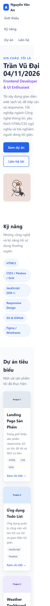
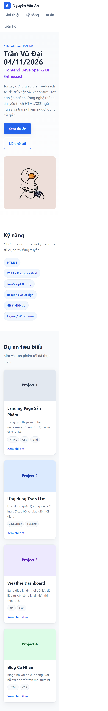
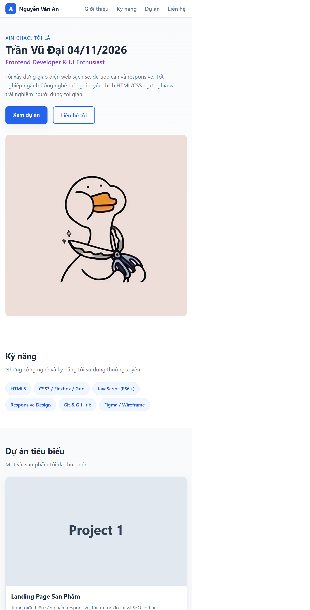

# Báo cáo kiểm thử sản phẩm

## Thông tin chung

| Hạng mục | Thông tin |
|---|---|
| Tên dự án | My-CV — Portfolio Cá Nhân |
| Phiên bản kiểm thử | v1.0.0 |
| Ngày kiểm thử | 05/11/2026 |
| Người thực hiện/đánh giá | GitHub Copilot (hỗ trợ kiểm thử); người nghiệm thu: _Chưa cung cấp_ |
| Phạm vi kiểm thử | Mã nguồn, tài liệu bàn giao và cấu trúc trang web tĩnh |
| Môi trường kiểm thử | Windows 11, trình duyệt hiện đại; chưa có nhật ký kiểm thử trên thiết bị cụ thể |
| Loại kiểm thử | Đánh giá tĩnh, kiểm tra tài liệu và kiểm tra cấu trúc |

## Bảng tổng quan trạng thái

| STT | Nhóm tiêu chí | Trạng thái tổng thể | Nhận định ngắn |
|---:|---|---|---|
| 1 | Tính đúng đắn và mức độ đáp ứng yêu cầu chức năng | Cần cải thiện | Đã có các chức năng CV cơ bản, nhưng chưa có báo cáo/checklist nghiệm thu chi tiết và minh chứng chạy thực tế. |
| 2 | Giao diện, trải nghiệm người dùng và khả năng tương thích | Đạt một phần | CSS hỗ trợ responsive và có thiết kế mobile-first, nhưng chưa có kết quả kiểm thử trên các trình duyệt và kích thước màn hình cụ thể. |
| 3 | Khả năng vận hành, xử lý lỗi và hiệu năng cơ bản | Cần cải thiện | Không có backend hoặc logic phức tạp; cần kiểm tra tải trang, liên kết, hình ảnh và trạng thái lỗi thực tế. |
| 4 | Bảo mật, quản lý cấu hình và dữ liệu | Đạt một phần | Trang tĩnh hạn chế rủi ro phía máy chủ và không lưu dữ liệu người dùng; cần rà soát liên kết công khai, thông tin nhạy cảm và cấu hình triển khai. |
| 5 | Chất lượng mã nguồn, cấu trúc repository và tài liệu bàn giao | Đạt | Có README, release note và nhật ký AI rõ ràng; mã nguồn được tổ chức thành HTML, CSS và assets. |
| 6 | Khả năng triển khai, kiểm thử và cung cấp minh chứng | Cần cải thiện | Có hướng dẫn chạy thử, nhưng chưa có script kiểm thử tự động, pipeline CI/CD hoặc bằng chứng kiểm thử đã lưu trong repository. |

## 1. Tính đúng đắn và mức độ đáp ứng yêu cầu chức năng

| Hạng mục kiểm tra | Trạng thái | Ghi chú/Minh chứng cụ thể |
|---|---|---|
| Trang hiển thị đúng vai trò và thông tin giới thiệu | Đạt | `index.html` chứa phần Hero giới thiệu tên, vai trò và mô tả. |
| Danh sách kỹ năng được trình bày đầy đủ | Đạt | `index.html` có phần **Kỹ năng**, sử dụng các thẻ HTML/CSS. |
| Danh sách dự án được hiển thị | Đạt | `index.html` có phần **Dự án tiêu biểu** dạng card. |
| Thông tin liên hệ hoạt động | Cần cải thiện | Có các liên kết Email, GitHub và LinkedIn trong `index.html`; cần xác minh URL và hành vi mở liên kết trên từng môi trường. |
| Điều hướng đến các section hoạt động | Cần cải thiện | Menu điều hướng cuộn đến từng section; cần kiểm thử trực tiếp trên trình duyệt. |
| Nút quay về đầu trang hoạt động | Cần cải thiện | Chức năng đã được triển khai trong giao diện; cần kiểm thử tương tác thực tế. |
| Cuộn mượt và hỗ trợ giảm chuyển động | Đạt một phần | CSS có quy tắc liên quan cuộn và `prefers-reduced-motion`; cần kiểm chứng trong trình duyệt. |
| Không có chức năng ngoài phạm vi gây sai lệch | Đạt | README xác nhận đây là trang tĩnh, không yêu cầu backend hoặc cơ sở dữ liệu. |

## 2. Giao diện, trải nghiệm người dùng và khả năng tương thích

| Hạng mục kiểm tra | Trạng thái | Ghi chú/Minh chứng cụ thể |
|---|---|---|
| Thiết kế responsive trên điện thoại | Đạt | Đã chụp minh chứng ở kích thước mobile 390 x 844; giao diện hiển thị một cột, điều hướng và nội dung không bị che khuất. Xem `docs/screenshots/mobile.png`. |
| Thiết kế responsive trên máy tính bảng | Đạt | Đã chụp minh chứng ở kích thước tablet 768 x 1024; bố cục chuyển sang 2 cột phần dự án và nội dung dễ đọc. Xem `docs/screenshots/tablet.png`. |
| Thiết kế responsive trên máy tính để bàn | Đạt | Đã chụp minh chứng ở kích thước desktop 1440 x 900; bố cục desktop hiển thị điều hướng ngang và đầy đủ nội dung. Xem `docs/screenshots/desktop.png`. |
| Không tràn ngang trang | Đạt một phần | Ảnh minh chứng mobile/tablet/desktop không cho thấy nội dung bị che hoặc tràn nhìn thấy được; cần kiểm tra thêm bằng công cụ đo thanh cuộn ở từng thiết bị thực tế. |
| Hình ảnh hiển thị đúng và không làm biến dạng bố cục | Đạt | Ảnh đại diện hiển thị đầy đủ và không làm thay đổi bố cục ở cả ba màn hình minh chứng. |
| Thứ tự nội dung và khả năng đọc | Chưa đạt | Chưa có đánh giá đọc, thứ tự heading, độ tương phản và trải nghiệm bàn phím bằng công cụ chuyên biệt. |
| Khả năng tương thích trình duyệt | Chưa đạt | Chưa có kết quả kiểm thử Chrome, Edge, Firefox hoặc Safari. |
| Hover và trạng thái tương tác có phản hồi | Đạt một phần | CSS định nghĩa hover cho liên kết, nút và card; cần kiểm tra bằng tương tác thực tế. |

### Minh chứng responsive

Các ảnh dưới đây được chụp trực tiếp từ trang `index.html` trong trình duyệt tích hợp.

#### Mobile — 390 x 844

#### Tablet — 768 x 1024

#### Desktop — 1440 x 900

## 3. Khả năng vận hành, xử lý lỗi và hiệu năng cơ bản

| Hạng mục kiểm tra | Trạng thái | Ghi chú/Minh chứng cụ thể |
|---|---|---|
| Trang tải thành công bằng đường dẫn trực tiếp | Đạt một phần | Hướng dẫn trong README cho phép mở `index.html`; cần kiểm tra thực tế trên trình duyệt. |
| Trang chạy bằng máy chủ HTTP cục bộ | Đạt một phần | README hướng dẫn chạy bằng Python hoặc Live Server; chưa lưu log chạy thực tế. |
| Không có lỗi JavaScript trong Console | Cần cải thiện | Trang không sử dụng JavaScript framework; cần kiểm tra Console ở môi trường chạy thực tế. |
| Không có lỗi tài nguyên 404 | Cần cải thiện | Cần kiểm tra CSS, hình ảnh và liên kết; chưa có báo cáo Network thực tế. |
| Xử lý lỗi khi hình ảnh không tải | Chưa đạt | Không thấy cơ chế fallback hình ảnh hoặc thông báo thay thế tương ứng. |
| Xử lý liên kết không hợp lệ | Chưa đạt | Chưa có danh sách liên kết ngoại lệ và kết quả kiểm tra HTTP. |
| Tốc độ tải trang cơ bản | Chưa đạt | Chưa đo kích thước tài nguyên, thời gian tải hoặc Core Web Vitals. |
| Không xảy ra bố cục nhảy khi tải hình ảnh | Cần cải thiện | Các thẻ dự án có thể cần thuộc tính kích thước rõ ràng; cần kiểm tra thực tế. |

## 4. Bảo mật, quản lý cấu hình và dữ liệu

| Hạng mục kiểm tra | Trạng thái | Ghi chú/Minh chứng cụ thể |
|---|---|---|
| Không chứa khóa/API token trong mã nguồn | Đạt | Không phát hiện khóa hoặc token trong tài liệu đã rà soát; cần chạy lệnh quét secret trước bàn giao. |
| Không thu thập dữ liệu người dùng trái phép | Đạt | Trang tĩnh không có backend, database hoặc form lưu dữ liệu. |
| Liên kết Email/GitHub/LinkedIn là dữ liệu công khai phù hợp | Cần cải thiện | Cần xác nhận liên kết là tài khoản thực và không tiết lộ thông tin nhạy cảm ngoài ý muốn. |
| Nội dung cấu hình có thể tùy chỉnh rõ ràng | Đạt | README mô tả cách thay nội dung, màu sắc, ảnh và liên kết. |
| Không có môi trường hoặc secret không cần thiết | Cần cải thiện | Repository hiện không yêu cầu cấu hình môi trường; cần xác nhận sau khi thêm pipeline hoặc máy chủ triển khai. |
| Nội dung và tài nguyên được quản lý qua repository | Đạt | Hình ảnh, CSS và HTML được lưu trong cấu trúc repository rõ ràng. |
| Không lưu thông tin cá nhân nhạy cảm không cần thiết | Cần cải thiện | Cần rà soát thông tin trong HTML trước khi công khai. |
| Link và tài nguyên ngoài được kiểm soát | Chưa đạt | Chưa có danh sách kiểm tra URL bên ngoài và chính sách thay đổi. |

## 5. Chất lượng mã nguồn, cấu trúc repository và tài liệu bàn giao

| Hạng mục kiểm tra | Trạng thái | Ghi chú/Minh chứng cụ thể |
|---|---|---|
| Repository có cấu trúc thư mục rõ ràng | Đạt | `index.html`, `assets/css`, `assets/img`, `README.md` và thư mục `docs` được phân tách hợp lý. |
| Tên file và thư mục nhất quán | Đạt | Các tên thư mục và file sử dụng quy ước dễ hiểu; ảnh được đặt trong `assets/img`. |
| Mã HTML có cấu trúc ngữ nghĩa | Đạt một phần | Trang có các section và heading; cần kiểm tra thứ tự heading, label và thuộc tính accessibility. |
| Mã CSS tổ chức và dễ bảo trì | Đạt một phần | CSS được phân vùng theo chức năng và có media query; nên rà soát trùng lặp và quy tắc không dùng. |
| Mã nguồn không chứa TODO/FIXME quan trọng chưa xử lý | Cần cải thiện | Cần chạy công cụ tìm kiếm tự động trước bàn giao để xác nhận repository không còn ghi chú dang dở. |
| README mô tả đủ cách cài đặt và chạy | Đạt | README có mục mô tả dự án, công nghệ, cài đặt, cấu hình và chạy thử. |
| Release note mô tả phiên bản | Đạt | `docs/RELEASENOTE.md` mô tả phiên bản v1.0.0, chức năng, lỗi đã sửa và hạn chế. |
| Nhật ký thay đổi AI được duy trì | Đạt | `docs/AI_LOG.md` ghi lại thay đổi lớn gần nhất và mẫu nhật ký. |
| Báo cáo kiểm thử có thể truy xuất | Đạt | Báo cáo này được lưu tại `docs/test_report.md`. |
| Repository có lịch sử commit rõ ràng | Đạt | Commit gần nhất ghi nhận thay đổi README, responsive image và tên trang chủ. |

## 6. Khả năng triển khai, kiểm thử và cung cấp minh chứng

| Hạng mục kiểm tra | Trạng thái | Ghi chú/Minh chứng cụ thể |
|---|---|---|
| Có hướng dẫn triển khai trang tĩnh | Đạt | README cung cấp các cách mở trực tiếp và chạy máy chủ HTTP. |
| Có thể triển khai trên máy chủ tĩnh | Đạt một phần | Cấu trúc HTML/CSS không phụ thuộc backend; cần xác nhận bằng triển khai thử. |
| Có Docker/CI/CD cho môi trường lặp lại | Chưa đạt | Không thấy Dockerfile, workflow CI/CD hoặc script build trong repository hiện tại. |
| Có bộ kiểm thử tự động | Chưa đạt | Workspace không có test controller hoặc test suite; không chạy được kiểm thử tự động qua VS Code. |
| Có checklist nghiệm thu | Đạt một phần | Báo cáo này cung cấp checklist chi tiết; cần người QA/khách hàng xác nhận trạng thái và ký duyệt. |
| Có ảnh chụp màn hình minh chứng | Chưa đạt | Chưa lưu ảnh desktop, tablet và mobile trong thư mục minh chứng. |
| Có log lỗi và kết quả kiểm thử | Chưa đạt | Chưa có log Console, Network, Lighthouse, HTML validator hoặc tài liệu kết quả tương ứng. |
| Quy trình phát hiện và theo dõi lỗi đã được xác định | Cần cải thiện | Repository có GitHub issue; cần quy tắc phân loại, ưu tiên và trạng thái đóng/mở. |
| Sản phẩm có thể khôi phục hoặc quay lại phiên bản trước | Đạt một phần | Có Git để quản lý mã nguồn; cần quy trình release/tag rõ ràng cho v1.0.0. |

## Đánh giá tổng kết & Đề xuất

### Nhận định chung

Phiên bản v1.0.0 hiện là một portfolio tĩnh với cấu trúc rõ ràng, giao diện responsive và tài liệu bàn giao cơ bản. Mã nguồn và README đã đáp ứng phần lớn yêu cầu ở mức chức năng thiết kế, tuy nhiên sản phẩm chưa đủ minh chứng để kết luận đã sẵn sàng bàn giao hoặc triển khai công khai.

### Mức độ sẵn sàng

**Chưa sẵn sàng bàn giao đầy đủ** cho đến khi hoàn thành các kiểm thử thực tế trên trình duyệt, thiết bị và môi trường triển khai.

### Vấn đề cần khắc phục trước bàn giao

1. Kiểm tra toàn bộ liên kết điều hướng, Email, GitHub và LinkedIn.
2. Kiểm thử giao diện trên ít nhất Chrome, Edge và Firefox ở kích thước mobile, tablet và desktop.
3. Kiểm tra Console, Network và các tài nguyên bị lỗi (404, CSS, ảnh).
4. Đo hiệu năng cơ bản bằng Lighthouse hoặc công cụ tương đương và lưu kết quả.
5. Kiểm tra accessibility về heading, tabindex, độ tương phản và khả năng điều hướng bằng bàn phím.
6. Quét secret/token, rà soát thông tin cá nhân nhạy cảm và xác nhận URL công khai.
7. Tạo báo cáo minh chứng gồm ảnh chụp màn hình, log kiểm thử và danh sách lỗi đã sửa/chưa sửa.
8. Thiết lập bộ kiểm thử tự động tối thiểu cho link, tài nguyên và cấu trúc HTML nếu sản phẩm tiếp tục phát triển.
9. Gắn tag/release cho phiên bản v1.0.0 và lưu artifact triển khai nếu có quy trình bàn giao chính thức.

## Quy trình ký duyệt

| Vai trò | Họ tên | Kết luận | Ngày ký duyệt | Chữ ký |
|---|---|---|---|---|
| Người kiểm thử |  |  |  |  |
| Người phát triển |  |  |  |  |
| Người nghiệm thu |  |  |  |  |